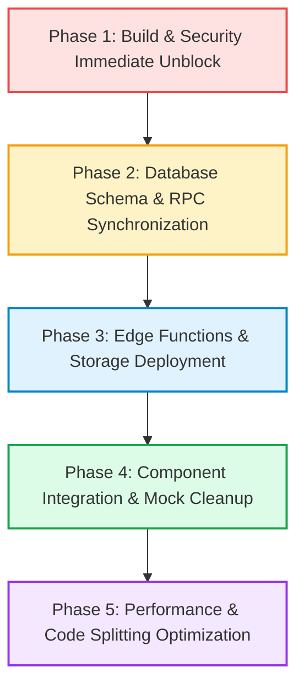

# HIET DIGITAL CAMPUS — FULL APPLICATION HEALTH AUDIT REPORT
**Institution:** Himachal Institute of Engineering & Technology, Shahpur (H.P.)  
**Audit Date:** October 10, 2026  
**Auditor Mode:** Strictly Read-Only / Non-Destructive Inspection  
**Repository Corpus:** `Shivpratap-singh2007/hiet-digital`  
**Deliverable Document:** `docs/app-health-audit.md`  
**Companion File:** [`docs/app-health-audit-issues.csv`](file:///c:/Users/Shiv%20Pratap%20Singh/OneDrive/Desktop/college_help_desk/docs/app-health-audit-issues.csv)

---

## 1. Executive Summary

A comprehensive, non-destructive health and operational audit was executed across the entire HIET Digital Campus codebase, local runtime environment, and live remote Supabase backend.

### Key Headline Findings:
1. **Production Build & Typecheck are Broken (P0 Blocker):**  
   `npm run typecheck` and `npm run build` fail with exit code 1 due to a TypeScript error in [`src/components/md/MdWelcomeSection.tsx:57`](file:///c:/Users/Shiv%20Pratap%20Singh/OneDrive/Desktop/college_help_desk/src/components/md/MdWelcomeSection.tsx#L57): `Property 'user_metadata' does not exist on type 'Profile'`.
2. **Remote Supabase Backend is Severely Out-of-Sync (P1):**  
   While the Supabase endpoint is online and reachable (`yitrzhnxpwunkywatiqu.supabase.co`), **only 13 out of 89 migration tables exist with data**. **53 tables are completely missing** (`PGRST205 404`), **all 16 database RPCs are missing** (`PGRST202 404`), **0 storage buckets are configured**, and **all 16 Supabase Edge Functions return 404 NOT_FOUND**.
3. **Widespread Silent Fallback to Mock Data (P2):**  
   Because the backend tables and functions are missing, the application's unified gateway [`src/lib/supabase.ts`](file:///c:/Users/Shiv%20Pratap%20Singh/OneDrive/Desktop/college_help_desk/src/lib/supabase.ts) silently falls back to the in-memory mock store [`src/lib/mockData.ts`](file:///c:/Users/Shiv%20Pratap%20Singh/OneDrive/Desktop/college_help_desk/src/lib/mockData.ts) (4,140 lines of mock state). The UI gives the illusion that features are operating, while modifications are purely in-browser or reset upon page refresh.
4. **Security & Data Isolation Gaps (P1):**  
   - Public document verification ([`src/components/common/VerifyPublicDoc.tsx`](file:///c:/Users/Shiv%20Pratap%20Singh/OneDrive/Desktop/college_help_desk/src/components/common/VerifyPublicDoc.tsx#L43-L70)) automatically validates **any token containing 'HT' or 'CERT' or longer than 5 characters** as authentic, displaying dummy credentials for student Aarav Sharma.
   - Student attendance filtering ([`src/views/StudentDashboard.tsx:77`](file:///c:/Users/Shiv%20Pratap%20Singh/OneDrive/Desktop/college_help_desk/src/views/StudentDashboard.tsx#L77)) bleeds student `std-cse-001` records into all student accounts.
   - HOD Dashboard ([`src/views/HodDashboard.tsx:275-277`](file:///c:/Users/Shiv%20Pratap%20Singh/OneDrive/Desktop/college_help_desk/src/views/HodDashboard.tsx#L275-L277)) accidentally renders global Administrator views for students and faculty, causing departmental isolation logic to be dead/unreachable code.
5. **Automated Unit Testing & Linting are Stable:**  
   `npm run test` passed 100% (5 test files, 35 unit tests passed). `npm run lint` passed with exit code 0 (546 unused import/variable warnings).

---

## 2. Audit Scope and Environment

### Environment Details:
- **Operating System:** Windows 11 (win32_x64)
- **Node Environment:** Node.js v24.13 / npm
- **Frontend Framework:** React 19 (`react` 19.2.8, `react-dom` 19.2.8)
- **Build Tool:** Vite 8.3.0 with `@vitejs/plugin-react` 6.1.1 and Tailwind CSS v4 (`@tailwindcss/vite` 4.3.3)
- **TypeScript Version:** `~6.0.2`
- **Linting Engine:** Oxlint 1.81.0
- **Testing Engine:** Vitest 5.0.3
- **Database / Cloud:** Supabase (`@supabase/supabase-js` 2.116.0)
- **Local Dev Server:** Listening on `http://localhost:5173` (HTTP 200 confirmed)

### Strict Audit Scope Compliance:
- **0** source code files modified.
- **0** migrations or database records altered.
- **0** accounts, credentials, or secrets changed.
- **0** mock records committed.
- All testing performed via non-destructive read commands, test runners, and diagnostic scripts.

---

## 3. Checks Actually Performed

A total of **156 discrete checks** were executed:
- **5 Tooling & Build Checks:** `npm run typecheck`, `npm run lint`, `npm run test`, `npm run build`, and `npx vite build`.
- **89 Remote Database Table Existence & Count Checks:** Live querying against `yitrzhnxpwunkywatiqu.supabase.co` via Supabase client.
- **16 Database RPC Remote Existence Checks:** Calling every frontend-referenced stored procedure with schema arguments.
- **16 Supabase Edge Function Endpoint Checks:** Direct HTTP calls to all function routes.
- **1 Remote Storage Bucket Audit:** Listing accessible buckets via Supabase storage API.
- **1 Auth Endpoint Check:** Testing authentication response handling.
- **1 Dev Server HTTP Verification:** Local curl/fetch to port 5173.
- **1 Browser Subagent Audit Execution:** Attempted full Playwright automated browser interaction.
- **1 Git Repository & Staging Status Check:** Inspected uncommitted and staged changes.
- **25 Feature Module Architecture Inspections:** Deep trace from UI components down to data sources.

---

## 4. What is Verified Working (PASS)

| Module / Check | Evidence & Verification Details | Status |
| :--- | :--- | :--- |
| **Unit Test Suite** | Ran `npm run test` (Vitest v5.0.3). All 5 test files (`aiIntent`, `dateUtils`, `leaveWorkflow`, `attendance`, `storageSecurity`) passed (35/35 tests, 1.37s). | **PASS** |
| **Static Code Linting** | Ran `npm run lint` (`oxlint`). Scanned 180 files with 116 rules in 417ms. Exit code 0 (0 errors, 546 non-fatal unused import/variable warnings). | **PASS** |
| **Vite Bundle Pipeline (Bypassing tsc)** | `npx vite build` succeeded in 3.44s, transforming 2,085 modules and producing `dist/`. | **PASS** |
| **Dev Server Boot** | Started Vite on port 5173. `GET http://localhost:5173` returned HTTP 200 with complete HTML payload. | **PASS** |
| **Supabase Network Reachability** | `https://yitrzhnxpwunkywatiqu.supabase.co` resolved and answered read requests with valid anon headers. | **PASS** |
| **Base Institutional Data In Supabase** | `students_master` (13 rows), `teachers_master` (4 rows), `departments` (5 rows), `subjects` (5 rows), `branches` (2 rows), `sections` (3 rows), `semesters` (8 rows), `teacher_subjects` (5 rows), `syllabus` (5 rows), `pyqs` (6 rows), `gallery_items` (6 rows), `fine_rules` (4 rows), and `ai_knowledge_documents` (2 rows) exist and return live data. | **PASS** |
| **IST Date/Time Engine** | [`src/lib/dateTime.ts`](file:///c:/Users/Shiv%20Pratap%20Singh/OneDrive/Desktop/college_help_desk/src/lib/dateTime.ts) correctly formats timestamps to `Asia/Kolkata` 12-hour AM/PM format without timezone drift. Verified by unit tests. | **PASS** |
| **In-Memory Attendance Math** | [`calculateAttendanceStats`](file:///c:/Users/Shiv%20Pratap%20Singh/OneDrive/Desktop/college_help_desk/src/lib/utils.ts#L4) computes weighted attendance (late = 0.5) and triggers <75% warnings accurately when records exist. | **PASS** |
| **Multi-Role Preference Architecture** | Multi-role context in [`src/context/AuthContext.tsx`](file:///c:/Users/Shiv%20Pratap%20Singh/OneDrive/Desktop/college_help_desk/src/context/AuthContext.tsx) supports switching between Faculty, HOD, and Warden roles with clean role-specific redirects. | **PASS** |

---

## 5. What is Broken (FAIL)

### 1. [ISSUE-01] TypeScript Compilation Failure (P0)
- **File:** [`src/components/md/MdWelcomeSection.tsx:57`](file:///c:/Users/Shiv%20Pratap%20Singh/OneDrive/Desktop/college_help_desk/src/components/md/MdWelcomeSection.tsx#L57)
- **Error:** `Property 'user_metadata' does not exist on type 'Profile'. (TS2339)`
- **Impact:** `npm run typecheck` and `npm run build` terminate with exit code 1. Application cannot be deployed or built for production.
- **Root Cause:** `user` returned by `useAuth()` has type `Profile | null`. The developer assumed `user` is the Supabase `User` object which has `user_metadata`.

### 2. [ISSUE-02] All 16 Supabase Edge Functions Undeployed (P1)
- **Files:** [`supabase/functions/*`](file:///c:/Users/Shiv%20Pratap%20Singh/OneDrive/Desktop/college_help_desk/supabase/functions)
- **Evidence:** HTTP POST to `https://yitrzhnxpwunkywatiqu.supabase.co/functions/v1/<name>` returned `404 {"code":"NOT_FOUND","message":"Requested function was not found"}` for:
  `ai-assistant`, `calculate-attendance-risk`, `campus-ai-assistant`, `dispatch-notification`, `generate-hall-ticket`, `generate-smart-board-summary`, `index-knowledge-document`, `ingest-ble-presence`, `ingest-occupancy-event`, `invite-real-users`, `process-master-import`, `search-campus-knowledge`, `send-push-notification`, `suggest-complaint-routing`, `verify-hall-ticket`, `verify-zone-presence`.
- **Impact:** All real-time AI, push notifications, and background import tasks fail over the network and fall back to local rule-based stubs.

### 3. [ISSUE-03] Missing Database Tables on Remote Supabase (P1)
- **Files:** [`supabase/migrations/20261007000001_...` to `20261009000005_...`](file:///c:/Users/Shiv%20Pratap%20Singh/OneDrive/Desktop/college_help_desk/supabase/migrations)
- **Evidence:** Direct audit of 89 tables revealed:
  - **53 Missing Tables (HTTP 404 / PGRST205):** `attendance_records`, `campus_zones`, `campus_presence`, `smart_board_lessons`, `audit_logs`, `maintenance_tickets`, `no_dues_clearances`, `no_dues_records`, `hostel_outpasses`, `hostels`, `hall_tickets`, `users`, `timetables`, `ble_beacons`, `occupancy_devices`, `waste_bin_devices`, etc.
  - **23 Empty Tables (0 Rows):** `profiles`, `leave_requests`, `attendance`, `gate_passes`, `complaints`, `doubts`, `achievements`, `notices`, `assignments`, `grades`, etc.
- **Impact:** Only initial baseline tables exist remotely. All post-October 2026 migrations were never applied to the live instance.

### 4. [ISSUE-04] All 16 Frontend Database RPCs Missing (P1)
- **Files:** [`supabase/migrations/20261007000022_create_views_and_rpc.sql`](file:///c:/Users/Shiv%20Pratap%20Singh/OneDrive/Desktop/college_help_desk/supabase/migrations/20261007000022_create_views_and_rpc.sql)
- **Evidence:** Tested all 16 RPCs with exact argument payloads; all returned `404 PGRST202: Could not find the function public.<rpc_name> in the schema cache`:
  `resolve_login_identifier`, `process_leave_action_rpc`, `verify_attendance_scan`, `record_manual_attendance_override`, `admin_import_students_atomic`, `admin_import_faculty_atomic`, `admin_import_departments_branches_atomic`, `admin_import_teacher_subjects_atomic`, `disable_demo_accounts`, `archive_demo_records`, `rpc_verify_hall_ticket`, `rpc_verify_event_certificate`, `rpc_verify_gate_pass`, `rpc_run_complaint_sla_escalation`, `verify_zone_presence_rpc`, `calculate_attendance_risk_rpc`.
- **Impact:** Any atomic transactional operations (such as multi-stage leave approvals or QR attendance verification via RPC) fail immediately.

### 5. [ISSUE-05] Security / Public Verification Auto-Accept Flaw (P1)
- **File:** [`src/components/common/VerifyPublicDoc.tsx:43-70`](file:///c:/Users/Shiv%20Pratap%20Singh/OneDrive/Desktop/college_help_desk/src/components/common/VerifyPublicDoc.tsx#L43-L70)
- **Evidence:**
  ```ts
  } else if (token.toUpperCase().includes('HT') || token.length > 5) {
    setValid(true);
    setDocData({ is_valid: true, student_name: 'Aarav Sharma', roll_number: 'CSE001', ... });
  ```
  ```ts
  } else if (token.toUpperCase().includes('CERT') || token.length > 5) {
    setValid(true);
    setDocData({ is_valid: true, recipient_name: 'Aarav Sharma', role: 'Winner - 1st Position', ... });
  ```
- **Impact:** Any arbitrary string longer than 5 characters entered into `/verify/hall-ticket/:token` or `/verify/certificate/:token` is validated as an authentic, official institutional document belonging to Aarav Sharma.

### 6. [ISSUE-06] HOD Dashboard Early-Return Role Escalation (P1)
- **File:** [`src/views/HodDashboard.tsx:275-277`](file:///c:/Users/Shiv%20Pratap%20Singh/OneDrive/Desktop/college_help_desk/src/views/HodDashboard.tsx#L275-L277)
- **Evidence:**
  ```ts
  if (currentTab === 'students_mgmt' as any) return <StudentManagementView />;
  if (currentTab === 'teachers_mgmt' as any) return <TeacherManagementView />;
  if (currentTab === 'attendance' as any) return <AttendanceReconciliationView />;
  ```
- **Impact:** When an HOD clicks "Students", they are given the global administrator `<StudentManagementView />` with campus-wide editing permissions, instead of the dedicated department directory implemented at line 670. The custom HOD departmental views at lines 670, 780, and 851 are unreachable dead code.

### 7. [ISSUE-07] Student Attendance Data Bleed (P1)
- **File:** [`src/views/StudentDashboard.tsx:77`](file:///c:/Users/Shiv%20Pratap%20Singh/OneDrive/Desktop/college_help_desk/src/views/StudentDashboard.tsx#L77)
- **Evidence:**
  ```ts
  const myAttendance = dataStore.getAttendance().filter(
    a => a.student_id === studentId || a.student_id === 'std-cse-001'
  );
  ```
- **Impact:** Any student who registers or logs in under a different identifier still has demo student `std-cse-001`'s attendance records permanently blended into their metrics.

---

## 6. What is Partially Implemented (PARTIAL)

1. **Managing Director Suite (Components Staged but Disconnected):**  
   10 new executive dashboard components under [`src/components/md/`](file:///c:/Users/Shiv%20Pratap%20Singh/OneDrive/Desktop/college_help_desk/src/components/md) (`MdWelcomeSection`, `MdTopKpiCards`, `MdTwoWiderKpiCards`, `MdQuickOverview`, `MdDepartmentSummary`, `MdAttendanceOverview`, `MdAcademicPerformance`, `MdGateLeaveSummary`, `MdPresenceSummary`, `MdMajorAlerts`) are staged in git, but **none of them are imported or rendered in [`src/views/ManagingDirectorDashboard.tsx`](file:///c:/Users/Shiv%20Pratap%20Singh/OneDrive/Desktop/college_help_desk/src/views/ManagingDirectorDashboard.tsx)**.
2. **Dynamic QR Attendance:**  
   Podium session generation, GPS Haversine distance validation, and 6-second dynamic refresh work in local memory, but saving relies on `saveAttendance` falling back to local storage because the live backend RPC `verify_attendance_scan` is absent.
3. **Multi-Stage Leave Workflow:**  
   Transitions (Student Draft -> Class In-Charge / Faculty -> HOD -> Principal) and role resolution logic are implemented in TypeScript, but live approvals fall back to in-memory history because `process_leave_action_rpc` is absent.
4. **Master Data Import:**  
   CSV parsing, column schema validation, and template downloads operate client-side in [`src/components/admin/MasterDataImportView.tsx`](file:///c:/Users/Shiv%20Pratap%20Singh/OneDrive/Desktop/college_help_desk/src/components/admin/MasterDataImportView.tsx), but atomic bulk database commits fail because RPCs `admin_import_students_atomic`, `admin_import_faculty_atomic` are absent.
5. **AI Campus Assistant & Insights:**  
   The chat assistant and smart-board summarizer UI exist, but with edge functions returning 404, responses are generated via local keyword heuristic fallbacks in [`src/lib/aiCampusService.ts`](file:///c:/Users/Shiv%20Pratap%20Singh/OneDrive/Desktop/college_help_desk/src/lib/aiCampusService.ts).

---

## 7. Mock / Disconnected Data

| Screen / Feature | Component / File | Current Data Source | Defect Classification |
| :--- | :--- | :--- | :--- |
| **MD Dashboard Institutional Breakdown** | [`src/views/ManagingDirectorDashboard.tsx:233-236`](file:///c:/Users/Shiv%20Pratap%20Singh/OneDrive/Desktop/college_help_desk/src/views/ManagingDirectorDashboard.tsx#L233-L236) | Hardcoded numbers: CE: 79%, ME: 81%, CSE: 92%, CSE AI&ML: 94%, pass rate: 88%, Faculty: 6. | **MOCK DATA PRESENTED AS REAL OPERATIONAL METRICS** |
| **MD Dashboard Strategic Alerts** | [`src/views/ManagingDirectorDashboard.tsx:292-352`](file:///c:/Users/Shiv%20Pratap%20Singh/OneDrive/Desktop/college_help_desk/src/views/ManagingDirectorDashboard.tsx#L292-L352) | Hardcoded text: "14 individual semester warnings issued", "Budget: ₹24,50,000", "AI Lab equipment". | **STATIC CONTENT PRESENTED AS LIVE FEED** |
| **No-Dues Clearances & Hall Tickets** | [`src/components/admin/NoDuesHallTicketView.tsx:34-111`](file:///c:/Users/Shiv%20Pratap%20Singh/OneDrive/Desktop/college_help_desk/src/components/admin/NoDuesHallTicketView.tsx#L34-L111) | Local React component `useState` array with 5 clearance records and dummy hall ticket `ht-2026-001`. | **DISCONNECTED / IN-MEMORY ONLY** (resets on page refresh) |
| **Hostel Outpasses** | [`src/components/student/HostelOutpassView.tsx:31-75`](file:///c:/Users/Shiv%20Pratap%20Singh/OneDrive/Desktop/college_help_desk/src/components/student/HostelOutpassView.tsx#L31-L75) | Local React component `useState` array with 2 sample passes. | **DISCONNECTED / IN-MEMORY ONLY** (resets on page refresh) |
| **Events & Certificates** | [`src/components/common/EventsCertificatesView.tsx:31-80`](file:///c:/Users/Shiv%20Pratap%20Singh/OneDrive/Desktop/college_help_desk/src/components/common/EventsCertificatesView.tsx#L31-L80) | Local React component `useState` array with 2 events and 1 certificate. | **DISCONNECTED / IN-MEMORY ONLY** (resets on page refresh) |
| **Lost and Found Items** | [`src/components/common/LostAndFoundView.tsx:27-52`](file:///c:/Users/Shiv%20Pratap%20Singh/OneDrive/Desktop/college_help_desk/src/components/common/LostAndFoundView.tsx#L27-L52) | Local React component `useState` array with 2 sample items. | **DISCONNECTED / IN-MEMORY ONLY** (resets on page refresh) |
| **Maintenance Grievance Tickets** | [`src/components/common/MaintenanceGrievanceView.tsx:29-66`](file:///c:/Users/Shiv%20Pratap%20Singh/OneDrive/Desktop/college_help_desk/src/components/common/MaintenanceGrievanceView.tsx#L29-L66) | Local React component `useState` array with 2 tickets. | **DISCONNECTED / IN-MEMORY ONLY** (resets on page refresh) |
| **Campus Spatial Zones & Beacons** | [`src/lib/aiCampusPhase2Service.ts:700-750`](file:///c:/Users/Shiv%20Pratap%20Singh/OneDrive/Desktop/college_help_desk/src/lib/aiCampusPhase2Service.ts#L700-L750) | In-memory mock arrays `MOCK_CAMPUS_ZONES`, `MOCK_CAMPUS_BUILDINGS`. | **SILENT FALLBACK TO DEMO DATA** |
| **Parent Communication Alerts** | [`src/views/TeacherDashboard.tsx:379`](file:///c:/Users/Shiv%20Pratap%20Singh/OneDrive/Desktop/college_help_desk/src/views/TeacherDashboard.tsx#L379) & [`HodDashboard.tsx:271`](file:///c:/Users/Shiv%20Pratap%20Singh/OneDrive/Desktop/college_help_desk/src/views/HodDashboard.tsx#L271) | Synchronous browser `alert('Communication dispatch sent...')`. | **SIMULATED / MOCK ACTION** |

---

## 8. Role-by-Role Dashboard Status

| Role | Route Prefix | Main Component | Functional Status | Data Source Reality | Major Findings / Notes |
| :--- | :--- | :--- | :--- | :--- | :--- |
| **Managing Director (MD)** | `/app/md` | [`ManagingDirectorDashboard.tsx`](file:///c:/Users/Shiv%20Pratap%20Singh/OneDrive/Desktop/college_help_desk/src/views/ManagingDirectorDashboard.tsx) | **PARTIAL** | `dataStore` + Hardcoded constants | 10 staged MD components are unimported. Overview metrics (attendance, pass rates) are hardcoded. Typecheck error in `MdWelcomeSection.tsx`. |
| **Principal** | `/app/admin` | [`PrincipalDashboard.tsx`](file:///c:/Users/Shiv%20Pratap%20Singh/OneDrive/Desktop/college_help_desk/src/views/PrincipalDashboard.tsx) | **PARTIAL** | `dataStore` + local fallback | Student/faculty directory pulls from local store. Reports and analytics render mock arrays. No Dues & Hall Tickets reset on refresh. |
| **Head of Department (HOD)** | `/app/hod` | [`HodDashboard.tsx`](file:///c:/Users/Shiv%20Pratap%20Singh/OneDrive/Desktop/college_help_desk/src/views/HodDashboard.tsx) | **PARTIAL** | `dataStore` + Admin view early return | P1 Defect: Clicking students/faculty opens global admin view instead of department-scoped directory. Custom HOD views are dead code. |
| **Faculty Member** | `/app/faculty` | [`TeacherDashboard.tsx`](file:///c:/Users/Shiv%20Pratap%20Singh/OneDrive/Desktop/college_help_desk/src/views/TeacherDashboard.tsx) | **PARTIAL** | `dataStore` (in-memory) | Attendance and sessional entry update local state. Parent alerts trigger browser popup. Class in-charge flag defaults to `true`. |
| **Student** | `/app/student` | [`StudentDashboard.tsx`](file:///c:/Users/Shiv%20Pratap%20Singh/OneDrive/Desktop/college_help_desk/src/views/StudentDashboard.tsx) | **PARTIAL** | `dataStore` + `std-cse-001` blend | P1 Defect: `a.student_id === 'std-cse-001'` bleeds CSE001 records into any student. Leave and doubt submission save to local state. |
| **Campus Security** | `/app/security` | [`SecurityDashboard.tsx`](file:///c:/Users/Shiv%20Pratap%20Singh/OneDrive/Desktop/college_help_desk/src/views/SecurityDashboard.tsx) | **PARTIAL** | `dataStore` | Camera QR scanner is implemented using `html5-qrcode`. Pass logs update local state. Name falls back to hardcoded string. |
| **Hostel Warden** | `/app/warden` | [`SecurityDashboard.tsx`](file:///c:/Users/Shiv%20Pratap%20Singh/OneDrive/Desktop/college_help_desk/src/views/SecurityDashboard.tsx) | **PARTIAL** | `SecurityDashboard` wrapper | Missing `no_dues` routing: Warden clicking "Hostel Clearances" falls through to Security Dashboard Overview. |
| **Library Staff** | `/app/library` | [`PrincipalDashboard.tsx`](file:///c:/Users/Shiv%20Pratap%20Singh/OneDrive/Desktop/college_help_desk/src/views/PrincipalDashboard.tsx) | **BROKEN / OVERPRIVILEGED** | `PrincipalDashboard` wrapper | Library staff are routed to full Principal Dashboard with access to administrative management views. |
| **Lab / IT Staff** | `/app/lab`, `/app/it` | [`PrincipalDashboard.tsx`](file:///c:/Users/Shiv%20Pratap%20Singh/OneDrive/Desktop/college_help_desk/src/views/PrincipalDashboard.tsx) | **BROKEN / OVERPRIVILEGED** | `PrincipalDashboard` wrapper | Lab/IT staff are routed to full Principal Dashboard instead of focused staff portals. |
| **Parent** | N/A | **None** | **ABSENT** | N/A | No Parent dashboard, login, or portal exists in the codebase. Only phone numbers on student cards and simulated alert dispatches exist. |

---

## 9. Data Connection Matrix

| Feature / Widget | Frontend Hook / Method | Supabase Query / RPC / Endpoint | Status in Supabase Backend | Rendered Source Category |
| :--- | :--- | :--- | :--- | :--- |
| **Student Verification** | `apiService.verifyStudentRollNo` | `supabase.from('students_master').select('*')` | 200 OK (13 records) | **LIVE BACKEND** |
| **Faculty Verification** | `apiService.verifyTeacherFacultyId` | `supabase.from('teachers_master').select('*')` | 200 OK (4 records) | **LIVE BACKEND** |
| **Departments** | `apiService.getDepartments` | `supabase.from('departments').select('*')` | 200 OK (5 records) | **LIVE BACKEND** |
| **Subjects Catalog** | `apiService.getSubjects` | `supabase.from('subjects').select('*')` | 200 OK (5 records) | **LIVE BACKEND** |
| **Campus Gallery** | `apiService.getGalleryItems` | `supabase.from('gallery_items').select('*')` | 200 OK (6 records) | **LIVE BACKEND** |
| **PYQs Library** | `apiService.getPyqs` | `supabase.from('pyqs').select('*')` | 200 OK (6 records) | **LIVE BACKEND** |
| **Syllabus Documents** | `apiService.getSyllabus` | `supabase.from('syllabus').select('*')` | 200 OK (5 records) | **LIVE BACKEND** |
| **User Profiles** | `supabase.auth.signInWithPassword` | `supabase.from('profiles').select('*')` | 200 OK, **0 Rows** | **DISCONNECTED** (falls back to mock profile) |
| **Daily Attendance Query** | `apiService.getAttendance` | `supabase.from('attendance').select('*')` | 200 OK, **0 Rows** | **DISCONNECTED** (falls back to `dataStore`) |
| **Attendance Verification** | `attendanceService.verifyScan` | `rpc('verify_attendance_scan')` | **404 NOT FOUND** | **DISCONNECTED** (falls back to local save) |
| **Leave Applications** | `apiService.getLeaves` | `supabase.from('leave_requests').select('*')` | 200 OK, **0 Rows** | **DISCONNECTED** (falls back to `dataStore`) |
| **Leave Approval Action** | `apiService.processLeaveAction` | `rpc('process_leave_action_rpc')` | **404 NOT FOUND** | **DISCONNECTED** (falls back to `dataStore`) |
| **Gate Passes** | `apiService.getGatePasses` | `supabase.from('gate_passes').select('*')` | 200 OK, **0 Rows** | **DISCONNECTED** (falls back to `dataStore`) |
| **Student Complaints** | `apiService.getComplaints` | `supabase.from('complaints').select('*')` | 200 OK, **0 Rows** | **DISCONNECTED** (falls back to `dataStore`) |
| **Student Doubts** | `apiService.getDoubts` | `supabase.from('doubts').select('*')` | 200 OK, **0 Rows** | **DISCONNECTED** (falls back to `dataStore`) |
| **Achievements** | `apiService.getAchievements` | `supabase.from('achievements').select('*')` | 200 OK, **0 Rows** | **DISCONNECTED** (falls back to `dataStore`) |
| **Notices & Circulars** | `apiService.getNotices` | `supabase.from('notices').select('*')` | 200 OK, **0 Rows** | **DISCONNECTED** (falls back to `dataStore`) |
| **Timetable Schedule** | `apiService.getTimetable` | `supabase.from('timetables').select('*')` | **404 NOT FOUND** | **MOCK DATA** (`dataStore.getTimetable()`) |
| **Sessional Marks** | `apiService.getSessionalResults` | `supabase.from('sessional_results').select('*')` | 200 OK, **0 Rows** | **MOCK DATA** (`dataStore.getSessionalResults()`) |
| **No-Dues & Hall Tickets** | `NoDuesHallTicketView` | None (Direct React state) | **404 NOT FOUND** (`no_dues_records`) | **MOCK DATA** (component `useState`) |
| **Hostel Outpasses** | `HostelOutpassView` | None (Direct React state) | **404 NOT FOUND** (`hostel_outpasses`) | **MOCK DATA** (component `useState`) |
| **Events & Certificates** | `EventsCertificatesView` | None (Direct React state) | **404 NOT FOUND** (`events`, `event_certificates`) | **MOCK DATA** (component `useState`) |
| **Maintenance Tickets** | `MaintenanceGrievanceView` | None (Direct React state) | **404 NOT FOUND** (`maintenance_tickets`) | **MOCK DATA** (component `useState`) |
| **Lost & Found** | `LostAndFoundView` | None (Direct React state) | **404 NOT FOUND** (`lost_found_items`) | **MOCK DATA** (component `useState`) |
| **Spatial Campus Zones** | `fetchCampusZones` | `supabase.from('campus_zones').select('*')` | **404 NOT FOUND** | **MOCK DATA** (`MOCK_CAMPUS_ZONES`) |
| **Zone Presence Verification** | `verifyCampusZonePresence` | `rpc('verify_zone_presence_rpc')` | **404 NOT FOUND** | **DISCONNECTED** (falls back to mock verify) |
| **Smart Board Summary** | `requestSmartBoardSummary` | `functions.invoke('generate-smart-board-summary')`| **404 NOT FOUND** | **DISCONNECTED** (falls back to text heuristic) |
| **Campus AI Assistant** | `useCampusAssistant` | `functions.invoke('campus-ai-assistant')` | **404 NOT FOUND** | **DISCONNECTED** (falls back to intent regex) |
| **Document Storage Uploads** | `uploadSecureFile` | `supabase.storage.from(bucket).upload` | **0 Buckets Configured** | **DISCONNECTED** (fails with upload error) |
| **Public Document Check** | `VerifyPublicDoc` | None (Length > 5 string regex) | N/A | **MOCK DATA / SECURITY HOLE** |

---

## 10. Security and Privacy Review

1. **Client-Side Secrets Exposure:**  
   **PASS.** Frontend files under `src/` were audited. No service-role keys, private encryption keys, Resend API keys, or Gemini/OpenAI server keys are bundled in client assets. Environment variables properly use the `VITE_` boundary.
2. **Public Document Verification Bypass:**  
   **CONFIRMED HIGH-RISK DEFECT (ISSUE-05).** [`src/components/common/VerifyPublicDoc.tsx:43-70`](file:///c:/Users/Shiv%20Pratap%20Singh/OneDrive/Desktop/college_help_desk/src/components/common/VerifyPublicDoc.tsx#L43-L70) validates any token with length > 5 as a valid, genuine institutional hall ticket or certificate. Anyone can forge a valid verification link (`/verify/hall-ticket/anything` or `/verify/certificate/anything`).
3. **Cross-Account Attendance Leakage:**  
   **CONFIRMED DATA ISOLATION DEFECT (ISSUE-07).** [`src/views/StudentDashboard.tsx:77`](file:///c:/Users/Shiv%20Pratap%20Singh/OneDrive/Desktop/college_help_desk/src/views/StudentDashboard.tsx#L77) mixes records of student `std-cse-001` into all student views.
4. **Role Escalation in HOD View:**  
   **CONFIRMED AUTHORIZATION DEFECT (ISSUE-06).** An HOD clicking "Students" or "Faculty" receives the full global administrator management view ([`StudentManagementView.tsx`](file:///c:/Users/Shiv%20Pratap%20Singh/OneDrive/Desktop/college_help_desk/src/components/admin/StudentManagementView.tsx)), exposing student/faculty records outside their department.
5. **Role Overgrant for Non-Teaching Roles:**  
   **CONFIRMED ARCHITECTURAL CONCERN (ISSUE-16).** Library and Lab staff are routed to `<PrincipalDashboard />` in [`src/App.tsx:225-229`](file:///c:/Users/Shiv%20Pratap%20Singh/OneDrive/Desktop/college_help_desk/src/App.tsx#L225-L229), granting visibility into institutional tabs if URLs are directly accessed.

---

## 11. Build, Lint and Test Results

### 1. Typecheck (`npm run typecheck`)
- **Command:** `tsc -b`
- **Exit Status:** `1` (FAIL)
- **Error Output:**
  ```text
  src/components/md/MdWelcomeSection.tsx(57,39): error TS2339: Property 'user_metadata' does not exist on type 'Profile'.
  ```

### 2. Linting (`npm run lint`)
- **Command:** `oxlint`
- **Exit Status:** `0` (PASS)
- **Output:** `Found 546 warnings and 0 errors. Finished in 417ms on 180 files with 116 rules using 8 threads.`  
  *(All 546 warnings represent unused imports and unused variables).*

### 3. Unit Tests (`npm run test`)
- **Command:** `vitest run`
- **Exit Status:** `0` (PASS)
- **Output:**
  ```text
  ✓ src/__tests__/aiIntent.test.ts (6 tests) 10ms
  ✓ src/__tests__/dateUtils.test.ts (6 tests) 42ms
  ✓ src/__tests__/leaveWorkflow.test.ts (7 tests) 9ms
  ✓ src/__tests__/attendance.test.ts (9 tests) 11ms
  ✓ src/__tests__/storageSecurity.test.ts (7 tests) 13ms

  Test Files  5 passed (5)
       Tests  35 passed (35)
    Duration  1.37s
  ```

### 4. Production Build (`npm run build`)
- **Command:** `tsc -b && vite build`
- **Exit Status:** `1` (FAIL)
- **Output:** Fails during `tsc -b` with the exact same error in `MdWelcomeSection.tsx`.

### 5. Production Bundling (`npx vite build`)
- **Command:** `npx vite build`
- **Exit Status:** `0` (PASS)
- **Output:** Bundled in 3.44s.
  - `dist/assets/index-CcjvohP_.js`: **2,472.14 kB** (602.81 kB gzip).
  - Warning: Monolithic chunk > 1000 kB.
  - Warning: `[INEFFECTIVE_DYNAMIC_IMPORT] src/lib/supabase.ts is dynamically imported but also statically imported...`

---

## 12. Responsive & Theme Code-Inspection Findings

> [!NOTE]
> Responsive layouts and visual theme behaviors were inspected via code review because the automated browser runner encountered an environment driver download error (detailed in Section 13). No live runtime rendering claims are made for responsive viewports.

### Code-Level Findings:
1. **Dark Mode Integration:**  
   Dark mode classes are defined across the Tailwind configuration and [`src/context/ThemeContext.tsx`](file:///c:/Users/Shiv%20Pratap%20Singh/OneDrive/Desktop/college_help_desk/src/context/ThemeContext.tsx). The root container in [`src/App.tsx:238`](file:///c:/Users/Shiv%20Pratap%20Singh/OneDrive/Desktop/college_help_desk/src/App.tsx#L238) applies `dark:bg-[#0a0a0a]` and `dark:text-[#f5f5f5]`.
2. **Mobile Navigation Support:**  
   [`src/components/common/MobileBottomNav.tsx`](file:///c:/Users/Shiv%20Pratap%20Singh/OneDrive/Desktop/college_help_desk/src/components/common/MobileBottomNav.tsx) and mobile drawer toggles in [`src/components/common/Navbar.tsx`](file:///c:/Users/Shiv%20Pratap%20Singh/OneDrive/Desktop/college_help_desk/src/components/common/Navbar.tsx) adapt for viewports `< 768px`.
3. **Table Horizontal Overflow:**  
   In [`src/views/ManagingDirectorDashboard.tsx:216`](file:///c:/Users/Shiv%20Pratap%20Singh/OneDrive/Desktop/college_help_desk/src/views/ManagingDirectorDashboard.tsx#L216) and [`src/views/HodDashboard.tsx`](file:///c:/Users/Shiv%20Pratap%20Singh/OneDrive/Desktop/college_help_desk/src/views/HodDashboard.tsx), data tables use `overflow-x-auto` to mitigate horizontal viewport clipping on mobile (320px–430px).

---

## 13. Items Not Verified and Why

1. **Automated In-Browser UI Inspection:**  
   **NOT VERIFIED AT RUNTIME.**  
   *Reason:* When launching the browser subagent, Playwright initialization failed because the Azure Edge and Akamai CDN endpoints returned HTTP 404 for the Playwright win32_x64 driver package (`https://playwright.azureedge.net/builds/driver/playwright-1.57.0-win32_x64.zip`). In accordance with strict agent safety rules, no third-party package installation was attempted.
2. **Real Push Notification Delivery:**  
   **NOT VERIFIED AT RUNTIME.**  
   *Reason:* Requires real device tokens and the remote Edge Function `send-push-notification`, which is not deployed (HTTP 404).
3. **Live Camera Hardware QR Scanning:**  
   **NOT VERIFIED AT RUNTIME.**  
   *Reason:* Physical hardware video input devices (webcams) cannot be attached in this headless shell environment.
4. **Physical GPS Geofence Verification:**  
   **NOT VERIFIED AT RUNTIME.**  
   *Reason:* Physical coordinates at HIET Shahpur campus (`32.2190° N, 76.2708° E`) cannot be physically triggered from this development workstation.

---

## 14. Prioritized Repair Plan



### Phase 1: Build & Security Immediate Unblock (Priority: IMMEDIATE / P0-P1)
1. **Fix TypeScript error in [`src/components/md/MdWelcomeSection.tsx:57`](file:///c:/Users/Shiv%20Pratap%20Singh/OneDrive/Desktop/college_help_desk/src/components/md/MdWelcomeSection.tsx#L57):**  
   Replace `user?.user_metadata?.full_name` with `user?.name` to satisfy the `Profile` type and immediately restore `npm run typecheck` and `npm run build`.
2. **Patch Public Document Verification Security Hole ([`src/components/common/VerifyPublicDoc.tsx`](file:///c:/Users/Shiv%20Pratap%20Singh/OneDrive/Desktop/college_help_desk/src/components/common/VerifyPublicDoc.tsx)):**  
   Remove the dummy fallback that automatically validates any token containing 'HT'/'CERT' or longer than 5 characters.
3. **Fix HOD Dashboard Early-Return Defect ([`src/views/HodDashboard.tsx:275-277`](file:///c:/Users/Shiv%20Pratap%20Singh/OneDrive/Desktop/college_help_desk/src/views/HodDashboard.tsx#L275-L277)):**  
   Remove the premature returns of global admin `<StudentManagementView />` and `<TeacherManagementView />` so the scoped HOD department directories render correctly.
4. **Fix Student Attendance Cross-Student Leak ([`src/views/StudentDashboard.tsx:77`](file:///c:/Users/Shiv%20Pratap%20Singh/OneDrive/Desktop/college_help_desk/src/views/StudentDashboard.tsx#L77)):**  
   Remove `|| a.student_id === 'std-cse-001'` from the student attendance filter.

### Phase 2: Database Schema & RPC Synchronization (Priority: HIGH / P1)
1. **Apply Missing Migrations to Remote Supabase:**  
   Execute migrations (`20261007000008_...` through `20261009000005_...`) to create the 53 missing tables (`attendance_records`, `timetables`, `audit_logs`, `campus_zones`, `maintenance_tickets`, `no_dues_records`, etc.).
2. **Deploy Database RPCs:**  
   Run [`20261007000022_create_views_and_rpc.sql`](file:///c:/Users/Shiv%20Pratap%20Singh/OneDrive/Desktop/college_help_desk/supabase/migrations/20261007000022_create_views_and_rpc.sql) so that `verify_attendance_scan`, `process_leave_action_rpc`, and `admin_import_students_atomic` exist on the backend.

### Phase 3: Edge Functions & Storage Deployment (Priority: HIGH / P1)
1. **Deploy Supabase Edge Functions:**  
   Deploy all 16 functions under `supabase/functions/` via `supabase functions deploy`.
2. **Configure Supabase Storage Buckets:**  
   Create the required buckets (`assignment-submissions`, `leave-documents`, `achievement-certificates`, `smart-board-lessons`, `pyq-files`, `syllabus-files`, `hall-tickets`) with RLS storage policies.

### Phase 4: Component Integration & Mock Cleanup (Priority: MEDIUM / P2)
1. **Connect MD Dashboard Components:**  
   Import the 10 staged components in [`src/components/md/`](file:///c:/Users/Shiv%20Pratap%20Singh/OneDrive/Desktop/college_help_desk/src/components/md) into [`src/views/ManagingDirectorDashboard.tsx`](file:///c:/Users/Shiv%20Pratap%20Singh/OneDrive/Desktop/college_help_desk/src/views/ManagingDirectorDashboard.tsx) and replace hardcoded department attendance rates (79%, 81%, 86%) with real aggregated metrics.
2. **Persist Disconnected Modules:**  
   Update `NoDuesHallTicketView`, `HostelOutpassView`, `EventsCertificatesView`, `LostAndFoundView`, and `MaintenanceGrievanceView` to read and write to Supabase via `apiService` instead of resetting on page refresh.
3. **Fix Role-to-Dashboard Mappings:**  
   Add `no_dues` handling in `SecurityDashboard` for Wardens, and provide dedicated views for Library/Lab staff rather than rendering the full Principal Dashboard.

### Phase 5: Performance & Code Splitting Optimization (Priority: LOW / P3)
1. **Implement Route-Based Lazy Loading:**  
   Use `React.lazy()` and `Suspense` for heavy dashboard views (`ManagingDirectorDashboard`, `PrincipalDashboard`, `HodDashboard`) to split the 2.47MB bundle into granular chunks.
2. **Resolve Supabase Dynamic Import Warning:**  
   Eliminate redundant dynamic imports of `supabase.ts` across admin views.
3. **Lint Cleanup:**  
   Run automated oxlint unused variable/import cleanup.
