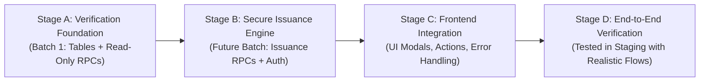

# HIET DIGITAL CAMPUS — SECURE DOCUMENT ISSUANCE DESIGN
**Document Type:** Technical Architecture Specification  
**Status:** Design Only — Implementation Deferred to Subsequent Batch  
**Scope:** Server-Side Issuance Lifecycle for Hall Tickets and Event Certificates  

---

## 1. Feature Lifecycle & Maturity Stages

To prevent presenting partial foundation work as complete feature delivery, the lifecycle of institutional document handling is structured into four distinct maturity gates:



- **Stage A (Batch 1 Scope):** Deploys the database schema (`events`, `event_certificates`, `hall_tickets`) and read-only verification endpoints (`rpc_verify_hall_ticket`, `rpc_verify_event_certificate`).
- **Stage B (Future Scope):** Implements server-side issuance RPCs with cryptographic token generation and strict role authorization.
- **Stage C (Future Scope):** Connects frontend issuance views (`NoDuesHallTicketView.tsx`, `EventsCertificatesView.tsx`) to real backend mutations.
- **Stage D (Future Scope):** Full verification of the end-to-end issuance-to-verification loop in a staging environment.

> [!IMPORTANT]
> Batch 1 achieves **only Stage A**. Hall Tickets and Certificates are **not** fully unblocked until Stages B and C are deployed and verified.

---

## 2. Hall Ticket Issuance Specification

### 2.1 Authorized Issuer Roles
- **Role Requirement:** Strictly restricted to Examination Officers (`admin` or faculty assigned the `'exam_controller'` permission).
- **Enforcement:** Enforced at the database level inside `rpc_issue_hall_ticket`:
  ```sql
  IF NOT EXISTS (
      SELECT 1 FROM public.profiles 
      WHERE auth_user_id = auth.uid() AND role IN ('admin', 'hod')
  ) THEN
      RAISE EXCEPTION 'Unauthorized: Only examination officers and administrators may issue hall tickets.';
  END IF;
  ```

### 2.2 Student & Enrollment Validation
Before issuing a hall ticket, the backend must verify:
1. `student_id` exists in `public.students_master` with `status = 'active'`.
2. Student belongs to the requested `semester` and `department`.
3. (Future) No-dues clearance record has `overall_status = 'cleared'`.

### 2.3 Server-Side Token Generation
- **Token Format:** Opaque, high-entropy token prefixing the semester and exam code:
  `HT-{YEAR}-{SEM}-{UUIDv4_HEX_12}`  
  Example: `HT-2026-S6-f83b2a9e1d04`
- **Entropy:** Generated via PostgreSQL `gen_random_uuid()` or cryptographic pseudo-random byte generator (at least 64 bits of effective entropy), preventing brute-force enumeration.
- **Prohibition:** Demo tokens (`TEST-HT-2026-001`) are strictly forbidden in production.

### 2.4 Duplicate Issuance Prevention
- Enforced by database composite unique constraint:
  ```sql
  CONSTRAINT uq_student_exam_semester UNIQUE (student_id, exam_name, semester, academic_year)
  ```
- If a ticket already exists for the student and examination:
  - If `is_blocked = true`, issuance is rejected.
  - If already active, the existing verification token and PDF URL are returned (idempotent re-fetch).

### 2.5 Lifecycle States
1. `issued` (`is_valid = true, is_blocked = false`): Normal active status.
2. `blocked` (`is_blocked = true, block_reason = TEXT`): Suspended due to disciplinary action, fee default, or attendance shortage. Verification RPC returns `is_blocked: true` with reason.
3. `invalidated` (`is_valid = false`): Cancelled or superseded by a re-issued ticket.

---

## 3. Event Certificate Issuance Specification

### 3.1 Authorized Issuer Roles
- **Role Requirement:** Event Coordinators, HODs, or College Administrators (`teacher`, `hod`, `admin`).
- **Enforcement:** Must be the designated `created_by` coordinator of the event or an administrator.

### 3.2 Student & Event Validation
1. `event_id` exists in `public.events` with `is_active = true`.
2. `student_id` exists in `public.students_master` with `status = 'active'`.
3. Event date must be in the past or current date (cannot issue certificates for future unheld events).

### 3.3 Server-Side Token & Certificate Number Generation
- **Certificate Number Format:** `CERT-{CATEGORY_CODE}-{YEAR}-{SEQUENTIAL_OR_HASH}`  
  Example: `CERT-TECH-2026-0084`
- **Verification Token Format:** High-entropy UUID string formatted as:  
  `EC-{UUIDv4_HEX_16}`  
  Example: `EC-9c2b4e87a1d3f502`
- **Uniqueness Guarantee:** `verification_token TEXT UNIQUE` and `certificate_number VARCHAR(100) UNIQUE`.

### 3.4 Duplicate Issuance Prevention
- Enforced by composite unique constraint:
  ```sql
  CONSTRAINT uq_event_student_certificate UNIQUE (event_id, student_id)
  ```
- Prevents accidental double-issuance of attendance/participation certificates to the same student for a single event.

### 3.5 Lifecycle States
1. `issued` (`is_revoked = false`): Valid credential.
2. `revoked` (`is_revoked = true, revocation_reason = TEXT`): Cancelled due to disqualification, administrative error, or code of conduct breach. Public verification RPC returns `is_revoked: true` with explanation.

---

## 4. Audit & Ledger Requirements

Every issuance operation must record an immutable audit entry in an audit ledger:
- `issuer_user_id`: Resolved from `auth.uid()`.
- `issued_at`: Server timestamp `CURRENT_TIMESTAMP`.
- `document_type`: `'hall_ticket'` or `'event_certificate'`.
- `recipient_student_id`: Target student primary key.
- `generated_token_prefix`: First 8 characters of token for reference (full token kept private).
- `ip_address`: Captured from request headers where available.

---

## 5. Minimal Public Verification Response Shape

When a third party scans a QR code containing `verification_token`, the response must reveal **only credentials necessary for authenticity verification**, strictly withholding student private PII:

```json
// Allowed Public Response Shape:
{
  "is_valid": true,
  "student_name": "Aarav Sharma",
  "roll_number": "CSE001",
  "department": "Computer Science & Engineering",
  "semester": 6,
  "academic_year": "2025-26",
  "exam_name": "B.Tech End Semester Theory Examination June 2026",
  "issued_at": "2026-05-10T10:00:00Z"
}
```

```json
// Strictly Prohibited in Public Response:
{
  "student_id": "c0000001-...",      // Internal UUID
  "college_email": "...",           // Private email
  "phone": "...",                   // Mobile number
  "father_name": "...",             // Parent info
  "home_address": "...",            // Residential info
  "fee_status": "..."               // Financial info
}
```
