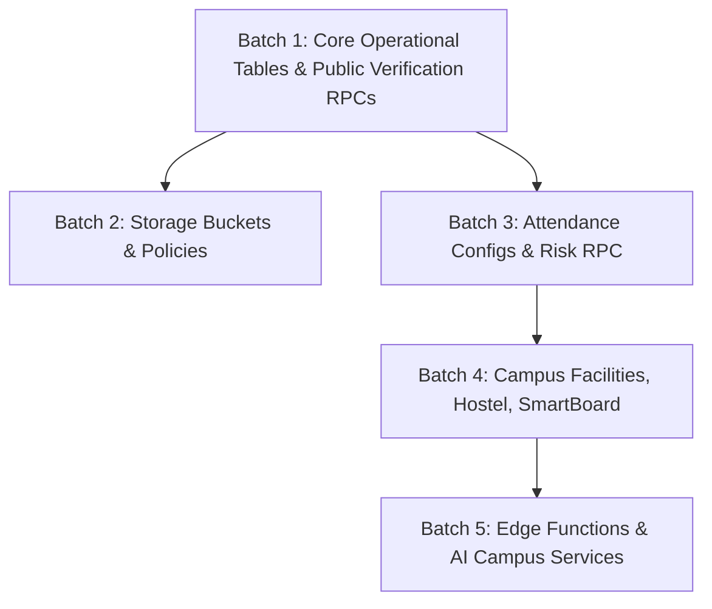

# HIET DIGITAL CAMPUS — PHASE 2: SAFE BACKEND DEPLOYMENT PLAN
**Version:** 1.0.0 (Phase 2A Output)  
**Inspection State:** Read-Only Complete — Zero Remote Mutations Executed  
**Target Project:** `yitrzhnxpwunkywatiqu` (`https://yitrzhnxpwunkywatiqu.supabase.co`)  

---

## 1. Safety Principles & Pre-Deployment Safeguards

1. **Strict Staging & Approval Protocol:**
   - No batch will be executed without explicit user confirmation.
   - Phase 2A establishes the verified blueprint; Phase 2B executes Batch 1 only upon approval.
2. **Preservation of Existing Data:**
   - The remote database already has active records in 11 tables (`departments`, `branches`, `students_master`, `teachers_master`, `subjects`, `teacher_subjects`, `timetable`, `syllabus`, `pyqs`, `fine_rules`, `gallery_items`).
   - Under no circumstances will `DROP TABLE`, `TRUNCATE`, or `ALTER COLUMN ... DROP NOT NULL` be executed on these tables.
3. **Rollback & Forward-Recovery Strategy:**
   - Prior to any remote migration execution, a pre-flight schema and data snapshot must be generated via a read-only backup script (`scripts/create_production_backup.mjs`).
   - Schema additions are additive (`CREATE TABLE IF NOT EXISTS`, `CREATE OR REPLACE FUNCTION`). If an issue occurs, the specific object can be isolated without rolling back previously healthy tables.

---

## 2. Proposed Deployment Batches (Dependency-Ordered)

---

### BATCH 1: Core Operational Tables & Public Verification RPCs
**Priority:** Highest (P1)  
**Risk Level:** Minimal (Additive only; zero impact on existing tables)  
**Status:** **AWAITING USER APPROVAL TO EXECUTE**  

#### 1. Exact Objects to Deploy
- **Tables:**
  1. `public.hall_tickets` (References `students_master.id`)
  2. `public.events` (Campus institutional events)
  3. `public.event_certificates` (References `events.id` & `students_master.id`)
  4. `public.gate_entries` (References `gate_passes.id`)
  5. `public.no_dues_clearances` (References `students_master.id`)
  6. `public.no_dues_records` (Departmental clearance breakdown)
- **Functions / RPCs (Reviewed and Corrected):**
  1. `public.rpc_verify_hall_ticket(p_token text)`:
     - **Bug Fix Incorporated:** Uses `sm.roll_no` (not `sm.roll_number`) and `LEFT JOIN public.users u` to ensure unlinked student accounts verify properly.
     - **Security:** `SECURITY DEFINER SET search_path = public`; returns only public verification data (`is_valid`, `student_name`, `roll_number`, `exam_name`, `semester`, `is_blocked`).
     - **Grant:** Granted to `anon`, `authenticated`.
  2. `public.rpc_verify_event_certificate(p_token text)`:
     - **Security:** `SECURITY DEFINER SET search_path = public`; returns verification metadata (`is_valid`, `student_name`, `roll_number`, `event_title`, `issue_date`, `is_revoked`).
     - **Grant:** Granted to `anon`, `authenticated`.
  3. `public.rpc_verify_gate_pass(p_token text, p_gate_name text, p_action text)`:
     - **Security:** `SECURITY DEFINER SET search_path = public`; logs scan entry into `gate_entries`.
     - **Grant:** Granted to `authenticated` (Security Staff / Admin).

#### 2. Features Unblocked
- Public QR Verification page (`src/components/common/VerifyPublicDoc.tsx`) for Hall Tickets and Event Certificates transitions from "Service Unavailable" (red badge) to genuine cryptographic token verification.
- Campus Security Gate scanning transitions from mock fallback to authentic logging in `gate_entries`.
- Student No Dues clearance verification for semester exams.

#### 3. Dependencies
- Depends on existing populated tables: `students_master`, `departments`, and `gate_passes`.

#### 4. Pre-Deployment Verification
- Run read-only check: Confirm `students_master` has column `roll_no` (verified: column exists).
- Confirm `gate_passes` table exists (verified: exists with 0 rows).

#### 5. Post-Deployment Verification Plan
- Run parameter query on `rpc_verify_hall_ticket` with test token `'TEST_NON_EXISTENT'`: must return `is_valid: false` (HTTP 200).
- Run parameter query on `rpc_verify_event_certificate` with test token `'TEST_NON_EXISTENT'`: must return `is_valid: false` (HTTP 200).
- Query `hall_tickets` and `event_certificates`: must return HTTP 200 with `[]` (PGRST205 resolved).

---

### BATCH 2: Storage Buckets & Storage Security Policies
**Priority:** High (P2)  
**Risk Level:** Low  

#### 1. Exact Objects to Deploy
- **Buckets Created via Supabase Storage API:**
  1. `leave-documents` (Private, max 10 MB, mime: `pdf`, `jpeg`, `png`)
  2. `assignment-submissions` (Private, max 20 MB, mime: `pdf`, `docx`, `txt`, `jpeg`, `png`)
  3. `profile-avatars` (Public, max 2 MB, mime: `jpeg`, `png`, `webp`)
- **Storage Policies:**
  - Enforce ownership isolation: `auth.uid()::text = (storage.foldername(name))[1]`
  - Teacher/Mentor read policies for submitted files.

#### 2. Features Unblocked
- Medical proof file uploads during student leave applications.
- Student assignment file submissions.
- Profile avatar uploads.

#### 3. Post-Deployment Verification Plan
- Read `/storage/v1/bucket`: Confirm all 3 buckets return in the listing.
- Test unauthorized access to `leave-documents`: Anonymous request must return HTTP 403 / 400.

---

### BATCH 3: Attendance Reconciliations & Risk Calculation System
**Priority:** Medium (P3)  
**Risk Level:** Low  

#### 1. Exact Objects to Deploy
- **Tables:**
  1. `public.attendance_policy_configs`
  2. `public.attendance_reconciliations`
  3. `public.notification_deliveries`
- **Functions / RPCs:**
  1. `public.rpc_calculate_attendance_risk(p_student_id uuid)`
  2. `public.rpc_reconcile_attendance_daily()`

#### 2. Features Unblocked
- HOD Departmental attendance rule thresholds (e.g. 75% mandatory, 65% medical grace).
- Attendance risk banner on student dashboard.
- Daily attendance reconciliation tracking.

---

### BATCH 4: Campus Facilities, Hostel, SmartBoard & Maintenance
**Priority:** Medium-Low (P4)  
**Risk Level:** Low  

#### 1. Exact Objects to Deploy
- **Tables:**
  1. `public.hostels`, `public.hostel_rooms`, `public.hostel_outpasses`
  2. `public.campus_zones`, `public.campus_presence`
  3. `public.smartboard_lessons`
  4. `public.maintenance_tickets`
  5. `public.audit_logs`

#### 2. Features Unblocked
- Hostel Warden room allocations and outpass verification.
- Classroom SmartBoard lesson slide storage.
- Facilities maintenance ticketing.
- Institutional audit trail.

---

### BATCH 5: Edge Functions & AI Campus Modules
**Priority:** Optional / Staged (P5)  
**Risk Level:** Medium (Requires external API keys & billing configuration)  

#### 1. Exact Objects to Deploy
- **Edge Functions:**
  1. `campus-ai-assistant`
  2. `dispatch-notification`
- **Tables:**
  1. `public.ai_chat_sessions`
  2. `public.ai_chat_messages`
  3. `public.ai_knowledge_base`
- **Required Secrets:**
  - `GEMINI_API_KEY` configured in Supabase Vault / Secrets.
  - `SUPABASE_SERVICE_ROLE_KEY` configured for background dispatch.

#### 2. Safeguards
- Do NOT deploy SMS/WhatsApp webhooks until external provider credentials are confirmed.

---

## 3. Stop Conditions & Escalation Criteria

Deployment must immediately pause and notify the operator if:
1. Any PostgREST probe returns HTTP 500 or connection failure.
2. Any migration statement attempts to drop or alter existing columns in `students_master`, `teachers_master`, `departments`, `subjects`, or `timetable`.
3. Verification RPC returns HTTP 401/403 for anonymous public document validation.
4. Storage bucket creation fails due to project tier or quota limits.

---

## 4. Next Step & Required Action

Phase 2A inspection and planning is complete.  
**Strict Safety Protocol:** Antigravity will now **STOP** and request operator approval for **Batch 1**.  
No remote database mutations or script deployments will occur until approval is received.
